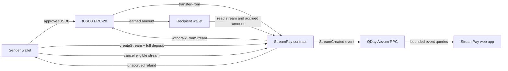

# Architecture

## Components

- **Next.js web app (`apps/web`)**: wallet connection, dashboard/forms, transaction state, and chain reads. It never holds funds or private keys.
- **StreamPay (`contracts/src/StreamPay.sol`)**: non-upgradeable escrow contract using SafeERC20, ReentrancyGuard, and Math.mulDiv.
- **tUSD8**: official Aevum Testnet ERC-20, 6 decimals, address `0x456569838f1d43009A91ebA4263147Afd7233483`.
- **Aevum RPC**: chain ID `44005`, `https://rpc-test.qday.info`. The official network page lists `https://explorer-test.qday.info`.
- **Event log**: indexed creation, withdrawal, and cancellation events let the app discover wallet-related streams without an on-chain unbounded array.

## Data flow



## Stream state and accounting

Each stream stores sender, recipient, total deposit, cumulative withdrawals, start/end timestamps, cancellation time, cancellation permission, and cancellation status.

For an active stream:

```text
elapsed = min(max(block.timestamp - startTime, 0), endTime - startTime)
accrued = floor(deposit * elapsed / duration)
withdrawable = accrued - withdrawn
```

At or after `endTime`, `accrued` returns `deposit` exactly. A cancellation is permitted only to the sender, only for a cancellable stream, and only before the end. Cancellation records its timestamp before transferring `deposit - accrued` back to the sender. The recipient's entitlement is frozen at the same timestamp.

## Frontend trust boundary

The animated counter advances from the most recent on-chain state using local time and is explicitly an estimate. Reads are periodically reconciled. A transaction is not represented as successful until its receipt is confirmed. Event history comes from bounded `getLogs` queries; event data is not synthesized if an RPC query fails.

## Deployment configuration

The deployment script accepts a private key only through Foundry's `PRIVATE_KEY` environment variable, rejects any chain other than `44005`, and passes the official tUSD8 address to the contract constructor. The contract has no admin or upgrade mechanism. A local mock is used only in automated tests.
